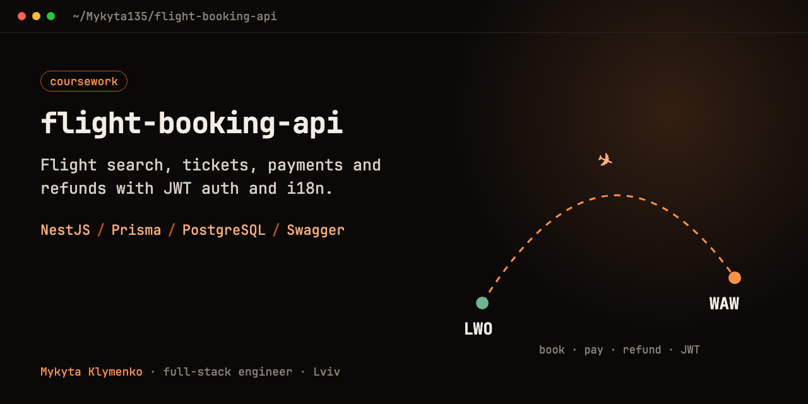

# flight-booking-api

University coursework: a flight booking platform with a NestJS + Prisma backend and a Next.js frontend. You search flights, hold seats, pay, get tickets, and can request a refund.

## The interesting part: seat holds

Two people must not be able to buy the same seat, and a seat someone abandoned at checkout must not stay locked forever.

- Booking a flight puts the seats on a **10-minute hold** and creates a `PENDING` booking with an expiry time.
- Every step of the purchase (hold, passenger details, payment) runs inside a **database transaction**, so a booking never ends up half-written.
- A **cron job runs every minute**, cancels expired `PENDING` bookings and releases their seats.
- Payment is simulated (no real gateway): it records the method and marks the booking paid, then tickets are issued.

## Features

- Flight search across airlines and airports
- Seat selection with temporary holds
- Bookings with multiple passengers, tickets per passenger
- Payments and refunds
- Booking history in the user profile
- JWT auth (Passport)
- Error messages in English and Ukrainian (`nestjs-i18n` on the backend, `next-intl` on the frontend)
- Swagger docs at `/api/docs`

## Data model

`Airline`, `Airport`, `Flight`, `FlightSeat`, `SeatReservation`, `User`, `Passenger`, `Booking`, `BookingPassenger`, `Ticket`, `Payment`, `Refund` in PostgreSQL via Prisma.

## Structure

```
backend/src/
├── auth/        # JWT login and registration, guards, strategies
├── flights/     # search and flight details
├── purchase/    # holds, bookings, payment, expiry cron
├── ticket/
├── refund/
├── myprofile/   # booking history
└── i18n/        # en, uk
frontend/        # Next.js 15 + next-intl
```

## Run

```bash
cd backend && npm install && npx prisma migrate dev && npm run start:dev
cd frontend && npm install && npm run dev
```

## Stack

NestJS · Prisma · PostgreSQL · Passport JWT · @nestjs/schedule · Swagger · Next.js 15 · next-intl · TypeScript
